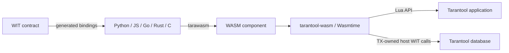

# tarantool-wasm

`tarantool-wasm` is a native Tarantool module for loading and executing
[WebAssembly components](https://component-model.bytecodealliance.org/). It
embeds Wasmtime, exposes Tarantool APIs to guest code through WIT interfaces,
and provides a small Lua API for component lifecycle and calls.

Use it when application logic should run close to Tarantool data but needs to
be written in a language other than Lua. Components can currently be built
from Python, JavaScript, Go, Rust, or C/C++ with
[`tarawasm`](https://github.com/mandesero/tarawasm).

## What this project provides

- A Wasmtime-based WebAssembly Component Model runtime loaded as `wasm.so`.
- WIT bindings for spaces, indexes, tuples, transactions, sessions, metrics,
  logging, MessagePack, key definitions, sequences, and other Tarantool APIs.
- WASI environment, arguments, standard I/O, filesystem, networking, HTTP,
  and TLS support.
- Several execution models: isolated calls, batches, persistent sessions,
  shared interpreter instances, and background `wasi:cli/run` tasks.
- Persistent compilation caching, reusable pre-instantiation, and optional AOT
  artifacts for large components.
- Resource limits for linear memory and Wasmtime fuel.
- A compiled-component cache and deterministic worker shutdown.



## Guest SDKs

`guests/` contains language-specific SDKs, interpreters, compatibility ports,
WIT contracts, and tests. The [Python SDK](guests/python/README.md) includes a
compatibility package and SSL/OpenSSL port; its tests run in a
[separate CI workflow](.github/workflows/guests-python.yml).

## Choose an execution model

| API | Instance lifetime | Best suited for |
| --- | --- | --- |
| `wasm.call` | New store and instance for one call on a shared worker pool | Isolated, stateless calls without per-call thread setup |
| `wasm.batch` | New store and instance per item on one pooled worker | Several isolated calls with less dispatch overhead |
| `wasm.open_session` / `session_call` | One store and instance until the session is closed | Stateful components and guest resources reused across calls |
| Interpreter mode | One warmed instance per component path | Large Python or other interpreter components |
| `wasm.run` | One instance for a background `wasi:cli/run` task | Long-running logic and guest-managed Tarantool transactions |
| `wasm.pipe.spawn` | One command instance with managed stdin/stdout/stderr | Interactive binary protocols over WASI stdio |

Compiled components are cached independently of instances. Loading unchanged
bytes from the same path avoids recompilation, but does not preserve guest
state unless a session or interpreter is used.

## Quick start

### 1. Build the runtime

Prerequisites are Rust 1.96 or newer, `cargo`, `just`, and a compatible
Tarantool build. Debug and release recipes build for the native host on Linux
and macOS.

Default builds also require OpenSSL development libraries (`openssl@3` on
macOS or `libssl-dev` on Debian/Ubuntu).

```sh
git clone https://github.com/tarantool/tarantool-wasm-rs.git
cd tarantool-wasm-rs

cargo install just
just install-wkg
just
```

The default recipe initializes the WASI TLS submodule, configures `wkg` to
fetch `tarantool:tarantool` packages from GHCR, fetches WIT dependencies, and
builds:

```text
target/debug/libtarantool_wasm_rs.so     # Linux
target/debug/libtarantool_wasm_rs.dylib  # macOS
```

Place the library where Tarantool can resolve `require('wasm')`. For a local
application this can be the current directory:

```sh
cp target/debug/libtarantool_wasm_rs.so ./wasm.so
```

Both `just build` and `just build-release` also install the resulting library
into `.rocks/lib/tarantool/wasm.so` on Linux or `wasm.dylib` on macOS. To repeat
the installation without rebuilding:

```sh
just install-module debug
# Or: just install-module release
```

### 2. Build a component

A component is defined by a WIT contract. This minimal contract exports one
function:

```wit
package example:calculator@0.1.0;

world calculator {
  export add: func(x: s32, y: s32) -> s32;
}
```

Save it as `wit/calculator.wit`, build the contract, and initialize a Python
component:

```sh
wkg wit build --wit-dir wit
tarawasm init --lang python \
  --wasm-file example:calculator@0.1.0.wasm calculator
tarawasm bind
```

Replace the generated `main.py` with:

```python
class Calculator:
    def add(self, x: int, y: int) -> int:
        return x + y
```

Then build it:

```sh
tarawasm build
```

The result is `calculator.wasm`. Installation instructions and Docker-based
tooling are available in the
[`tarawasm` documentation](https://github.com/mandesero/tarawasm).

To call Tarantool from a guest, import the interfaces you need from
[`tarantool:tarantool@0.2.0`](https://github.com/mandesero/tarantool-wit).
For example:

```wit
import tarantool:tarantool/types@0.2.0;
import tarantool:tarantool/database@0.2.0;
```

### 3. Call the component from Lua

```lua
local wasm = require('wasm')

local module = wasm.load('./calculator.wasm')

assert(wasm.call(module, 'add', 20, 22) == 42)

local results = wasm.batch(module, {
    {'add', 1, 2},
    {'add', 10, 20},
})
assert(results[1] == 3 and results[2] == 30)

wasm.drop(module)
```

Interface exports use the selector `<interface>::<function>`:

```lua
local value = wasm.call(
    module,
    'example:calculator/math@0.1.0::add',
    20,
    22
)
```

`bind` creates a Lua proxy for all callable exports:

```lua
local calculator = wasm.bind(module)
assert(calculator.add(20, 22) == 42)

local math = calculator['example:calculator/math@0.1.0']
assert(math.add(20, 22) == 42)
```

Export names and full interface names are preserved as table keys. The proxy
uses a persistent component instance so state and WIT resources survive
between calls. For a regular module it owns a managed session. For a module
loaded with `interpreter = true`, it uses the existing shared interpreter
instance. The proxy does not own the module; release the module with
`wasm.drop(module)` as usual.

WIT resources become Lua userdata. Constructors and static functions are
grouped under the resource name, while methods use Lua's `:` syntax:

```lua
local counters = calculator['example:calculator/counters@0.1.0']
local first = counters.counter.new(20)
local second = counters.counter.new(22)

assert(first:add(2) == 22)
assert(counters.counter.sum(first, second) == 44)

first:drop()
second:drop()
```

`own<T>` arguments consume their handle and `borrow<T>` arguments leave it
usable. A resource belongs to one component instance and cannot be passed to
another. Proxies for the same shared interpreter can exchange resources. Call
`resource:drop()` for deterministic cleanup; Lua garbage collection is a
fallback.

### Exchange streaming data with a command component

`wasm.pipe.spawn` creates a fresh `wasi:cli/run` instance and installs bounded
binary pipes before the guest starts. It does not attach to an instance already
started with `wasm.run`.

```lua
local wasm = require('wasm')
local module = wasm.load('./server.wasm', {
    args = {'server', '--stdio'},
    inherit_stdin = false,
    inherit_stdout = false,
    inherit_stderr = false,
})

local process = wasm.pipe.spawn(module, nil, {capacity = 64 * 1024})
assert(process:write('\0binary request', {timeout_ms = 1000}))
assert(process:close_stdin())

while true do
    local stream, data, eof = process:read_any({
        max_bytes = 64 * 1024,
        timeout_ms = 1000,
    })
    if stream == nil then
        assert(eof)
        break
    end
    consume(stream, data, eof)
end

assert(process:join({timeout_ms = 5000}))
assert(process:close())
assert(wasm.drop(module))
```

`write` accepts one atomic chunk no larger than `capacity`. If its deadline
expires, zero bytes from that chunk are accepted. `read` selects either stdout
or stderr; `read_any` multiplexes both streams and prevents a guest from
deadlocking when one bounded output fills. Reads return arbitrary chunks rather
than application records. EOF is reported only after the corresponding queue
has been drained.

`join` waits for the command result but never drains output or closes stdin.
Drain stdout and stderr concurrently, normally with `read_any`, before waiting
for completion. `cancel` requests termination while preserving bytes already
committed to host output queues. It closes stdin and advances the Wasmtime
engine epoch every 2 ms until this worker stops. Each Store checks its own
cancellation flag at epoch checkpoints, so canceling one pipe does not stop
another pipe, session, interpreter, or run on the shared Engine. A CPU-bound
guest with epoch-instrumented Wasm code normally stops within milliseconds;
there is no hard deadline during a blocking host call, native code, or a
starved OS thread. Use `join({timeout_ms = ...})` and an external process
watchdog for a strict wall-clock bound. A timed-out join remains retryable.
`join` reports `canceled` only when cancellation won; a guest failure remains
a guest error. Repeated cancel and join calls preserve the terminal result.
`close` cancels, joins, and releases endpoints only after worker completion;
garbage collection is a nonblocking fallback. The worker drops its Store and
transaction owner handle before publishing completion. The owner fiber then
rolls back any open transaction and exits on the Tarantool TX scheduler.
Runtime shutdown still interrupts all Stores and waits for every worker.

The pipe endpoints replace stdio inherited from the module's load config.
Passing explicit `stdin`, `stdout`, `stderr`, or `inherit_*` stdio fields in the
spawn override is rejected. Capacity is a bound for each shared queue, not an
absolute memory bound: every guest output handle can additionally stage up to
8 KiB while following the WASI `check-write`/`write` permit protocol.

### Call a registered Lua function from a guest

Register the function before executing the component:

```lua
local module = wasm.load('./callbacks.wasm')
local component = wasm.bind(module)

wasm.register_callback('normalize-user', function(user)
    return {id = user.id, name = string.upper(user.name)}
end, {timeout_ms = 100})

local normalized = component.normalize({id = 1, name = 'alice'})
assert(normalized.name == 'ALICE')

wasm.unregister_callback('normalize-user')
wasm.drop(module)
```

The guest opens a `lua-callback.handler` resource for the registered name and
calls the resource with MessagePack-encoded input. Existing resources resolve
the current Lua closure on every call, so replacement remains dynamic. Lua
coroutines and Tarantool fiber yields are supported. Recursive entry into an
already active component instance returns an error instead of blocking. See
[Lua callbacks](docs/lua_callbacks.md) for timeout, cancellation, execution
flow, and constraints.

Runtime counters and latency aggregates are available without stopping active
components:

```lua
local stats = wasm.stats()
print(stats.guest_execution.count, stats.guest_execution.total_ns)
print(stats.current.sessions, stats.memory.peak_bytes)
print(stats.traps.by_kind.out_of_fuel or 0)
```

The counters are process-wide and monotonic for the lifetime of the loaded
module. See [Runtime metrics](docs/runtime_metrics.md) for the complete schema
and measurement boundaries.

## Persistent sessions

Ordinary calls instantiate the component again for every export. A session
keeps one instance, its linear memory, and its resources alive:

```lua
local module = wasm.load('./stateful.wasm')
local session = wasm.open_session(module)

local first = wasm.session_call(session, 'next')
local second = wasm.session_call(session, 'next')

local values = wasm.session_batch(session, {
    {'next'},
    {'next'},
})

wasm.close_session(session)
wasm.drop(module)
```

Dropping a module also closes its open sessions.

## Shared interpreter mode

Large interpreter components are expensive to instantiate. Load them with
`interpreter = true` to keep one warmed instance per canonical path:

```lua
local python = wasm.load('./guests/python/interpreter/adder.wasm', {
    interpreter = true,
    memory_limit = 512 * 1024 * 1024,
    max_instructions = 5 * 1000 * 1000 * 1000,
})

wasm.interpreter_exec(python, [[
counter = 0
def next_value():
    global counter
    counter += 1
    return counter
]])

assert(wasm.interpreter_call(python, 'next_value') == 1)
assert(wasm.interpreter_call(python, 'next_value') == 2)

wasm.drop(python)
```

Loading the same path again shares the interpreter only when the complete
configuration is identical. The last `wasm.drop` closes the worker.

The instance and its Python globals are shared by every module identifier and
every Tarantool client using that canonical path. Ordinary interpreter errors
are returned to Lua and preserve the instance. A WASM trap, such as exhausted
fuel or a memory fault, recreates the instance and discards all shared state.
Calls are serialized; one long-running call delays all other users of the same
interpreter. Set `memory_limit` and `max_instructions` for untrusted or
potentially unbounded code.

`wasm.bind(python)` binds the component's static WIT exports to this same
warmed instance, including resource constructors and methods. The proxy also
provides module-bound interpreter helpers:

```lua
local bound = wasm.bind(python)
bound.interpreter_exec('def answer(): return 42')
assert(bound.interpreter_call('answer') == 42)
```

Resources can be shared between proxies backed by the same interpreter.
`interpreter_call` retains its MessagePack data boundary and does not accept
Lua resource userdata. A WASM trap invalidates resources created by the
previous instance.

Interpreter mode is not a security boundary. WASI inherits the Tarantool
process environment, standard streams, and network access by default. Disable
the corresponding `inherit_*` and `allow_*` options unless the executed code
needs them. Instructions for rebuilding the checked-in Python component are in
[`guests/python/interpreter/README.md`](guests/python/interpreter/README.md).

## Background execution

Components that export `wasi:cli/run` can execute in a background OS thread:

```lua
local module = wasm.load('./service.wasm')
local handle = wasm.run(module)

-- Do other Tarantool work, then wait for completion.
wasm.join(handle)
wasm.drop(module)
```

Cancel a long-running component instead of joining it:

```lua
local handle = wasm.run(module)
wasm.cancel(handle)
```

Both `join` and `cancel` consume the handle. Calling either operation again on
the same handle raises an error.

Guest transaction begin is supported only during `wasm.run`, where execution
can move onto the Tarantool TX thread until commit or rollback. Isolated calls,
sessions, and interpreter calls reject transaction begin because they cannot
preserve a Tarantool fiber transaction across host calls.

## Configuration

Pass configuration as the second argument to `wasm.load`:

```lua
local module = wasm.load('./component.wasm', {
    inherit_env = false,
    env = {APP_MODE = 'production'},
    args = {'--verbose'},

    inherit_stdin = false,
    stdout = './component.log',
    stderr = './component.err',

    inherit_network = true,
    allowed_ips = {'127.0.0.1'},
    allowed_ports = {8080},

    preopened_dirs = {
        {'./data', '/data', perms = 'ro'},
        {'./output', '/output', perms = 'rw'},
    },

    memory_limit = 128 * 1024 * 1024,
    max_instructions = 10_000_000,
})
```

Environment variables, standard streams, and networking are inherited by
default. Disable the corresponding `inherit_*` options when components should
run with least privilege.

`run` and `open_session` accept an optional configuration argument. When it is
present, it replaces the complete load configuration rather than merging
individual fields. Fuel support is selected at load time, so a later override
cannot add `max_instructions` to a module loaded without it.

The complete option reference is in the
[developer guide](docs/developer_guide.md#internal-apis).

## Lua API at a glance

```text
load(path[, opts])                         -> module_uid
exports(module_uid)                        -> table
bind(module_uid)                           -> table
call(module_uid, function, ...)            -> value
batch(module_uid, calls)                   -> values

open_session(module_uid[, opts])           -> session_uid
session_call(session_uid, function, ...)   -> value
session_batch(session_uid, calls)           -> values
close_session(session_uid)                 -> true

interpreter_exec(module_uid, source)       -> true
interpreter_call(module_uid, function, ...) -> value

run(module_uid[, opts])                    -> handle
join(handle)                               -> true
cancel(handle)                             -> true

drop(module_uid)                           -> true
register_callback(name, function)          -> true
unregister_callback(name)                  -> boolean
stats()                                    -> table
```

Arguments and results cross the boundary through MessagePack. See
[Mapping WIT types to Lua](docs/wit_to_lua_types.md) for exact representations
and current limitations.

## Supported platforms

Linux release builds are tested on x86-64 with Rust 1.96.0 and Tarantool 3.7.0.

| Distribution | Version | CI coverage | Support status |
| --- | --- | --- | --- |
| Debian | 12 (Bookworm) | Release build and full `luatest` suite | Supported |
| Fedora | 39 | Release build and full `luatest` suite | Supported |
| CentOS | 8 | Release build and full `luatest` suite | Supported |
| RED OS | 7.3.4 | Release build and full `luatest` suite | Supported |
| Astra Linux | 1.7 | Release build and full `luatest` suite | Supported |

Linux checks run in pinned PackPack containers.

The Linux release matrix can be reproduced locally with:

```sh
./scripts/test_distros.sh
```

See [Platform compatibility](docs/platform-support.md) for image names, GLIBC
requirements, and test scope.

## Development and testing

Build and place the debug module in the test loader path:

```sh
just
```

Install `luatest` once and run the suite:

```sh
just install-luatest
just test
```

Before submitting Rust changes, also run:

```sh
cargo fmt -- --check
cargo clippy --all-targets --all-features
```


The native release build is produced with `just build-release` at
`target/release/libtarantool_wasm_rs.so` on Linux or
`target/release/libtarantool_wasm_rs.dylib` on macOS and installed into `.rocks`.
Use `just test test/lualib/exports_args_test.lua` to run a single test file.

## Documentation

- [Developer guide](docs/developer_guide.md) — repository structure, Lua API,
  configuration, and contributor workflow.
- [Component execution](docs/wasm_component.md) — worker, call, batch, session,
  interpreter, cache, and shutdown behavior.
- [WIT-to-Lua type mapping](docs/wit_to_lua_types.md) — values and conversion
  limitations.
- [Lua callbacks](docs/lua_callbacks.md) — calling registered Lua functions
  from guest components.
- [Runtime metrics](docs/runtime_metrics.md) — `wasm.stats()` counters,
  latency aggregates, gauges, traps, fuel, cache, and memory semantics.
- [Thread-safety boundary](docs/thread-safety.md) — TX-only Tarantool APIs and
  the lifetime guarantees for worker-side operations.
- [Platform compatibility](docs/platform-support.md) — tested Linux images,
  GLIBC constraints, and CI coverage.

## Related projects

- [`tarawasm`](https://github.com/mandesero/tarawasm) — build tooling for guest
  components in Python, JavaScript, Go, Rust, and C/C++.
- [`tarantool-wit`](https://github.com/mandesero/tarantool-wit) — Tarantool host
  interface definitions.
- [`tarantool-wasm-samples`](https://github.com/mandesero/tarantool-wasm-samples)
  — complete examples.
- [Tarantool integration PR](https://github.com/tarantool/tarantool/pull/11793)
  — the `luawasm` wrapper and native runtime integration.
