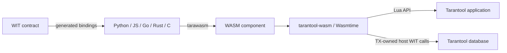

# tarantool-wasm

`tarantool-wasm` is a native Tarantool module for loading and executing
[WebAssembly components](https://component-model.bytecodealliance.org/). It
embeds Wasmtime, exposes Tarantool APIs to guest code through WIT interfaces,
and provides a small Lua API for component lifecycle and calls.

Use it when application logic should run close to Tarantool data but needs to
be written in a language other than Lua. Components can currently be built
from Python, JavaScript, Go, Rust, or C/C++ with
[`tarawasm`](https://github.com/mandesero/tarawasm).

## What this project provides

- A Wasmtime-based WebAssembly Component Model runtime loaded as `wasm.so`.
- WIT bindings for spaces, indexes, tuples, transactions, sessions, metrics,
  logging, MessagePack, key definitions, sequences, and other Tarantool APIs.
- WASI environment, arguments, standard I/O, filesystem, networking, HTTP,
  and TLS support.
- Several execution models: isolated calls, batches, persistent sessions,
  shared interpreter instances, and background `wasi:cli/run` tasks.
- Persistent compilation caching, reusable pre-instantiation, and optional AOT
  artifacts for large components.
- Resource limits for linear memory and Wasmtime fuel.
- A compiled-component cache and deterministic worker shutdown.



## Choose an execution model

| API | Instance lifetime | Best suited for |
| --- | --- | --- |
| `wasm.call` | New store and instance for one call | Isolated, stateless calls |
| `wasm.batch` | New store and instance per item, one worker thread for the batch | Several isolated calls with less thread overhead |
| `wasm.open_session` / `session_call` | One store and instance until the session is closed | Stateful components and guest resources reused across calls |
| Interpreter mode | One warmed instance per component path | Large Python or other interpreter components |
| `wasm.run` | One instance for a background `wasi:cli/run` task | Long-running logic and guest-managed Tarantool transactions |

Compiled components are cached independently of instances. Loading unchanged
bytes from the same path avoids recompilation, but does not preserve guest
state unless a session or interpreter is used.

## Quick start

### 1. Build the runtime

Prerequisites are Rust 1.94 or newer, `cargo`, `just`, and a compatible
Tarantool build. The release recipe currently targets Linux x86-64.

```sh
git clone https://github.com/tarantool/tarantool-wasm-rs.git
cd tarantool-wasm-rs

cargo install just
just install-wkg
just
```

The default recipe initializes the WASI TLS submodule, configures `wkg` to
fetch `tarantool:tarantool` packages from GHCR, fetches WIT dependencies, and
builds:

```text
target/debug/libtarantool_wasm_rs.so
```

Place the library where Tarantool can resolve `require('wasm')`. For a local
application this can be the current directory:

```sh
cp target/debug/libtarantool_wasm_rs.so ./wasm.so
```

For this repository's test suite, use its local rocks directory instead:

```sh
mkdir -p .rocks/lib/tarantool
cp target/debug/libtarantool_wasm_rs.so .rocks/lib/tarantool/wasm.so
```

### 2. Build a component

A component is defined by a WIT contract. This minimal contract exports one
function:

```wit
package example:calculator@0.1.0;

world calculator {
  export add: func(x: s32, y: s32) -> s32;
}
```

Save it as `wit/calculator.wit`, build the contract, and initialize a Python
component:

```sh
wkg wit build --wit-dir wit
tarawasm init --lang python \
  --wasm-file example:calculator@0.1.0.wasm calculator
tarawasm bind
```

Replace the generated `main.py` with:

```python
class Calculator:
    def add(self, x: int, y: int) -> int:
        return x + y
```

Then build it:

```sh
tarawasm build
```

The result is `calculator.wasm`. Installation instructions and Docker-based
tooling are available in the
[`tarawasm` documentation](https://github.com/mandesero/tarawasm).

To call Tarantool from a guest, import the interfaces you need from
[`tarantool:tarantool@0.1.4`](https://github.com/mandesero/tarantool-wit).
For example:

```wit
import tarantool:tarantool/types@0.1.4;
import tarantool:tarantool/ttbox@0.1.4;
```

### 3. Call the component from Lua

```lua
local wasm = require('wasm')

local module = wasm.load('./calculator.wasm')

assert(wasm.call(module, 'add', 20, 22) == 42)

local results = wasm.batch(module, {
    {'add', 1, 2},
    {'add', 10, 20},
})
assert(results[1] == 3 and results[2] == 30)

wasm.drop(module)
```

Interface exports use the selector `<interface>::<function>`:

```lua
local value = wasm.call(
    module,
    'example:calculator/math@0.1.0::add',
    20,
    22
)
```

## Persistent sessions

Ordinary calls instantiate the component again for every export. A session
keeps one instance, its linear memory, and its resources alive:

```lua
local module = wasm.load('./stateful.wasm')
local session = wasm.open_session(module)

local first = wasm.session_call(session, 'next')
local second = wasm.session_call(session, 'next')

local values = wasm.session_batch(session, {
    {'next'},
    {'next'},
})

wasm.close_session(session)
wasm.drop(module)
```

Dropping a module also closes its open sessions.

## Shared interpreter mode

Large interpreter components are expensive to instantiate. Load them with
`interpreter = true` to keep one warmed instance per canonical path:

```lua
local python = wasm.load('./python-interpreter.wasm', {
    interpreter = true,
})

wasm.interpreter_exec(python, [[
counter = 0
def next_value():
    global counter
    counter += 1
    return counter
]])

assert(wasm.interpreter_call(python, 'next_value') == 1)
assert(wasm.interpreter_call(python, 'next_value') == 2)

wasm.drop(python)
```

Loading the same path again shares the interpreter only when the complete
configuration is identical. The last `wasm.drop` closes the worker.

## Background execution

Components that export `wasi:cli/run` can execute in a background OS thread:

```lua
local module = wasm.load('./service.wasm')
local handle = wasm.run(module)

-- Do other Tarantool work, then wait for completion.
wasm.join(handle)
wasm.drop(module)
```

Cancel a long-running component instead of joining it:

```lua
local handle = wasm.run(module)
wasm.cancel(handle)
```

Both `join` and `cancel` consume the handle. Calling either operation again on
the same handle raises an error.

Guest transaction begin is supported only during `wasm.run`, where execution
can move onto the Tarantool TX thread until commit or rollback. Isolated calls,
sessions, and interpreter calls reject transaction begin because they cannot
preserve a Tarantool fiber transaction across host calls.

## Configuration

Pass configuration as the second argument to `wasm.load`:

```lua
local module = wasm.load('./component.wasm', {
    inherit_env = false,
    env = {APP_MODE = 'production'},
    args = {'--verbose'},

    inherit_stdin = false,
    stdout = './component.log',
    stderr = './component.err',

    inherit_network = true,
    allowed_ips = {'127.0.0.1'},
    allowed_ports = {8080},

    preopened_dirs = {
        {'./data', '/data', perms = 'ro'},
        {'./output', '/output', perms = 'rw'},
    },

    memory_limit = 128 * 1024 * 1024,
    max_instructions = 10_000_000,
})
```

Environment variables, standard streams, and networking are inherited by
default. Disable the corresponding `inherit_*` options when components should
run with least privilege.

`run` and `open_session` accept an optional configuration argument. When it is
present, it replaces the complete load configuration rather than merging
individual fields. Fuel support is selected at load time, so a later override
cannot add `max_instructions` to a module loaded without it.

The complete option reference is in the
[developer guide](docs/developer_guide.md#internal-apis).

## Lua API at a glance

```text
load(path[, opts])                         -> module_uid
exports(module_uid)                        -> table
call(module_uid, function, ...)            -> value
batch(module_uid, calls)                   -> values

open_session(module_uid[, opts])           -> session_uid
session_call(session_uid, function, ...)   -> value
session_batch(session_uid, calls)           -> values
close_session(session_uid)                 -> true

interpreter_exec(module_uid, source)       -> true
interpreter_call(module_uid, function, ...) -> value

run(module_uid[, opts])                    -> handle
join(handle)                               -> true
cancel(handle)                             -> true

drop(module_uid)                           -> true
```

Arguments and results cross the boundary through MessagePack. See
[Mapping WIT types to Lua](docs/wit_to_lua_types.md) for exact representations
and current limitations.

## Supported platforms

Release builds are tested on x86-64 with Rust 1.94.0 and Tarantool 3.7.0.

| Distribution | Version | CI coverage | Support status |
| --- | --- | --- | --- |
| Debian | 12 (Bookworm) | Release build and full `luatest` suite | Supported |
| Fedora | 39 | Release build and full `luatest` suite | Supported |
| CentOS | 8 | Release build and full `luatest` suite | Supported |
| RED OS | 7.3.4 | Release build and full `luatest` suite | Supported |
| Astra Linux | 1.7 | Release build and full `luatest` suite | Supported |

Linux checks run in pinned PackPack containers.

The Linux release matrix can be reproduced locally with:

```sh
./scripts/test_distros.sh
```

See [Platform compatibility](docs/platform-support.md) for image names, GLIBC
requirements, and test scope.

## Development and testing

Build and place the debug module in the test loader path:

```sh
just
mkdir -p .rocks/lib/tarantool
cp target/debug/libtarantool_wasm_rs.so .rocks/lib/tarantool/wasm.so
```

Install `luatest` once and run the suite:

```sh
just install-luatest
just test
```

Before submitting Rust changes, also run:

```sh
cargo fmt -- --check
cargo clippy --all-targets --all-features
```


The release build is produced with `just build-release` at
`target/x86_64-unknown-linux-gnu/release/libtarantool_wasm_rs.so`.

## Documentation

- [Developer guide](docs/developer_guide.md) — repository structure, Lua API,
  configuration, and contributor workflow.
- [Component execution](docs/wasm_component.md) — worker, call, batch, session,
  interpreter, cache, and shutdown behavior.
- [WIT-to-Lua type mapping](docs/wit_to_lua_types.md) — values and conversion
  limitations.
- [Thread-safety boundary](docs/thread-safety.md) — TX-only Tarantool APIs and
  the lifetime guarantees for worker-side operations.
- [Platform compatibility](docs/platform-support.md) — tested Linux images,
  GLIBC constraints, and CI coverage.

## Related projects

- [`tarawasm`](https://github.com/mandesero/tarawasm) — build tooling for guest
  components in Python, JavaScript, Go, Rust, and C/C++.
- [`tarantool-wit`](https://github.com/mandesero/tarantool-wit) — Tarantool host
  interface definitions.
- [`tarantool-wasm-samples`](https://github.com/mandesero/tarantool-wasm-samples)
  — complete examples.
- [Tarantool integration PR](https://github.com/tarantool/tarantool/pull/11793)
  — the `luawasm` wrapper and native runtime integration.
