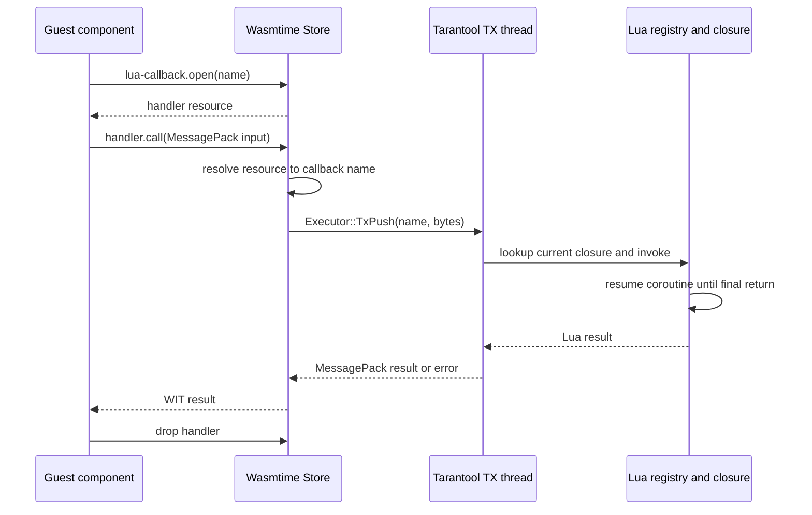

# Calling Lua through handler resources

Guest components call registered Lua closures through a host-owned WIT
resource. The resource is a stable capability inside one component instance;
the closure itself remains in Tarantool's Lua registry and never moves to a
Wasm worker thread.

## WIT contract

WIT cannot represent a Lua function value directly. The runtime exposes a
`handler` resource that stores a callback name and resolves that name whenever
the guest calls it:

```wit
interface lua-callback {
  resource handler {
    call: func(payload: list<u8>) -> result<list<u8>, string>;
  }

  open: func(name: string) -> result<handler, string>;
}
```

`open` creates a resource without requiring the Lua closure to be registered
yet. This permits a long-lived component to prepare its handler resources
before Tarantool installs or replaces the corresponding functions. An empty
name and resource-table failures are returned through the WIT `result`.

Request and response values use MessagePack. This preserves the Lua types
supported by the existing conversion layer without adding
application-specific records to the runtime ABI.

## Lua registry API

Register the closure under the name that the guest passes to `open`:

```lua
local wasm = require('wasm')

wasm.register_callback('normalize-user', function(user)
    return {
        id = user.id,
        name = string.upper(user.name),
    }
end, {timeout_ms = 100})
```

Registering the same name again atomically replaces the previous closure.
Every existing handler resource observes the replacement on its next call
because resources do not cache an `mlua::Function`.

The optional `timeout_ms` value must be a positive integer. It limits one
invocation rather than the lifetime of the registry entry. Omitting the option
keeps the callback unlimited for backward compatibility.

Remove the registry entry when the application no longer exposes it:

```lua
local existed = wasm.unregister_callback('normalize-user')
```

Unregistering does not invalidate or drop guest resources. Their subsequent
calls return an `is not registered` error. Dropping a guest resource has the
opposite scope: it releases that component's handle but does not unregister the
Lua closure.

## Guest usage

A guest can retain the resource and invoke it repeatedly. For example, a
componentize-py guest can keep handlers in its own routing or operation table:

```python
from wit_world.imports import lua_callback

handlers = {
    "normalize-user": lua_callback.open("normalize-user"),
}


def normalize(payload: bytes) -> bytes:
    return handlers["normalize-user"].call(payload)
```

The guest may open the resource before `wasm.register_callback` runs. Calls
start succeeding after registration without recreating the component or the
resource.

## Instance and registry lifetimes

Resource handles are local to a Wasmtime `Store` and cannot cross component
instances. Two components can nevertheless call the same Lua closure: each
opens its own handler resource with the same name, and both resources resolve
the process-wide registry entry.

```text
component A / handler("normalize-user") ─┐
                                        ├─ Lua registry entry ─ closure
component B / handler("normalize-user") ─┘
```

Sessions and shared interpreters can retain handler resources alongside their
other guest state. A one-shot `wasm.call` can create and use a resource during
that invocation, but the instance and resource disappear when the call
returns. A long-running `wasm.run` component can open resources from its event
loop and observes later registrations and replacements through the same
lookup-on-call behavior.

## Execution flow

Opening and dropping a handler only mutate the worker's Wasmtime resource
table. Calling it resolves the resource to a name, forwards owned bytes to the
Tarantool TX thread, and accesses Lua there.



Registration, replacement, invocation, and removal are serialized on the TX
thread. Concurrent calls from different component workers therefore execute
one at a time against the current registry entry.

## Yielding and cancellation

Each invocation creates an `mlua::Thread` from the registered closure.
`coroutine.yield()` suspends that thread, and the runtime resumes it with no
arguments until the closure returns its final value. Values passed to
`coroutine.yield()` are intermediate control values and are not sent to the
guest.

`fiber.yield()` and `fiber.sleep()` suspend the Tarantool fiber that executes
the TX callback. Other Tarantool fibers continue to run while the Wasm worker
waits for the handler result. This preserves the Lua fiber stack and resumes
the same callback after the yield.

The runtime checks `timeout_ms`, shutdown state, and guest-call cancellation
after every coroutine resume and from a Lua instruction hook. The hook
interrupts CPU-bound Lua code, including an infinite loop. Cancellation is
cooperative: native code that does not return to Lua and a long
`fiber.sleep()` are checked when control returns to the callback.

## Reentrant component calls

A callback may call a different idle component instance. The runtime carries
the active instance chain through nested calls and associates it with the
current Tarantool fiber. Calling an instance already present in that chain
returns `reentrant WASM call rejected` before a command is queued.

This rejects both direct recursion such as `A -> Lua -> A` and cycles such as
`A -> Lua -> B -> Lua -> A`. Calls from unrelated Tarantool fibers keep
separate chains, so a suspended callback does not make another component call
look recursive.

## Execution constraints

Handler calls remain synchronous from the guest's perspective. A callback
without `timeout_ms` can wait indefinitely, and slow Lua or native work still
delays the waiting guest. The timeout measures wall-clock time but is enforced
at cooperative boundaries; it does not preempt arbitrary native code.

Names still share one process-wide namespace and are not an authorization
boundary. The resource controls guest-side lifetime and type safety, but any
component linked to this interface can open any non-empty name. Applications
that require isolation should add an owner or capability token to the
registry.

The interface currently lives in the runtime's local `docs:adder` WIT package.
A stable release should move it into the versioned Tarantool WIT package so
guest toolchains consume the same published contract.

The integration test in
`test/bindings/bindings_lua_callback_test.lua` covers structured values,
resources created before registration, replacement observed by two component
instances, direct and cyclic reentrancy, interpreter instances, Tarantool
fiber yields, Lua coroutine yields, timeout, resource drop, invalid names, and
unregister behavior.
