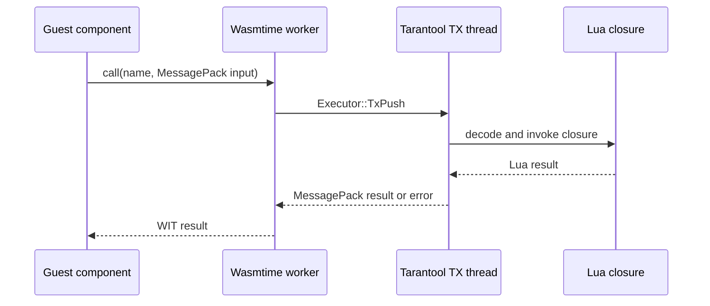

# Calling Lua from guest components

Guest components can call Lua closures registered by the embedding Tarantool
application. This allows guest code to delegate selected operations to Lua
without embedding application-specific behavior into the runtime ABI.

## Why callbacks use names

The WebAssembly Component Model does not have a first-class function value in
WIT. A Lua closure therefore cannot cross the component boundary directly.
The runtime uses a stable callback name as the cross-boundary handle and keeps
the actual closure in the Lua registry. A WIT `resource` with a `call` method
could provide stronger ownership semantics later, but would still be a handle
to a host-side Lua value rather than the function itself.

The prototype interface is:

```wit
interface lua-callback {
  call: func(name: string, payload: list<u8>)
    -> result<list<u8>, string>;
}
```

Payloads are MessagePack. This avoids forcing application-specific types into
the runtime ABI and preserves the Lua types already supported by the existing
MessagePack conversion layer.

## Lua API

Register a closure before starting or calling the guest component:

```lua
local wasm = require('wasm')

wasm.register_callback('normalize-user', function(user)
    return {
        id = user.id,
        name = string.upper(user.name),
    }
end)
```

Registering the same name again atomically replaces the previous closure.
Remove a callback when it is no longer reachable by a guest:

```lua
local existed = wasm.unregister_callback('normalize-user')
```

The guest encodes an input value, calls `lua-callback.call`, and decodes the
result. A missing callback, invalid MessagePack, Lua error, or result encoding
error is returned through the WIT `result` error.

## Execution flow



The closure is never moved to a worker thread. The worker captures only owned
strings and bytes, then resolves and invokes the closure after the existing TX
executor has entered Tarantool's Lua thread. Registration, replacement,
invocation, and removal are serialized by that thread.

## Integration patterns

Callbacks are independent of the component execution model:

- An isolated `wasm.call` can invoke a Lua function during one component call.
- A session or interpreter can reuse the same callback names across multiple
  calls while preserving guest state.
- A long-running `wasm.run` command can invoke callbacks from its own event or
  processing loop.

A typical integration registers the required functions, passes their names to
the guest as configuration or function arguments, executes the component, and
unregisters the functions when the application no longer exposes them.

## Constraints and follow-up work

- Calls are synchronous from the guest's perspective and Lua execution is
  serialized on the TX thread. A slow callback delays Tarantool and other guest
  host calls; callbacks should stay short.
- The callback must not yield. Supporting yielding Lua functions requires a
  Tarantool fiber/coroutine dispatcher rather than a plain TX callback.
- A callback should not re-enter the waiting component instance. Reentrant
  component calls need an explicit deadlock and instance-ownership design.
- Names currently share one process-wide namespace and have no per-component
  ACL. Production use should add an owner/capability token or a WIT resource.
- Lua must unregister application callbacks explicitly. A resource-based API
  could make ownership and automatic drop behavior clearer.
- The prototype interface lives in the runtime's local `docs:adder` WIT
  package. A stable release should move it into the versioned Tarantool WIT
  package so all guest toolchains consume the same contract.

The integration test under `test/bindings/bindings_lua_callback_test.lua`
demonstrates structured input and output, closure replacement, and
unregistration behavior.
