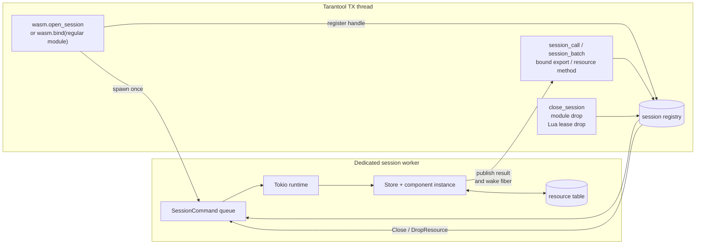
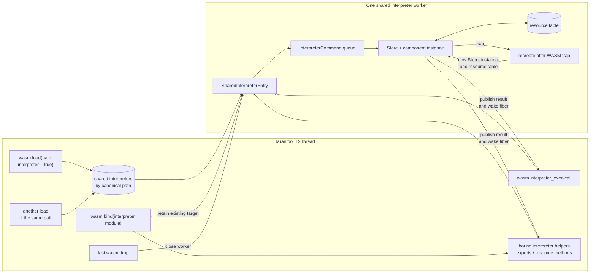
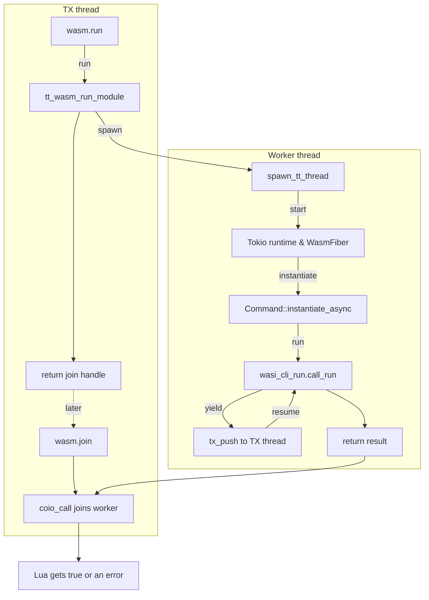
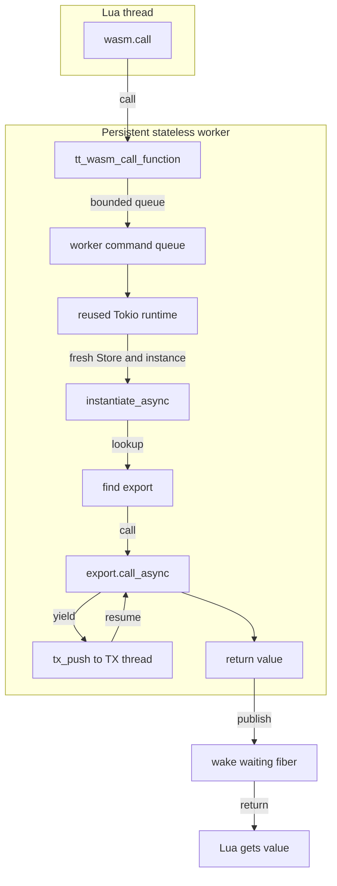
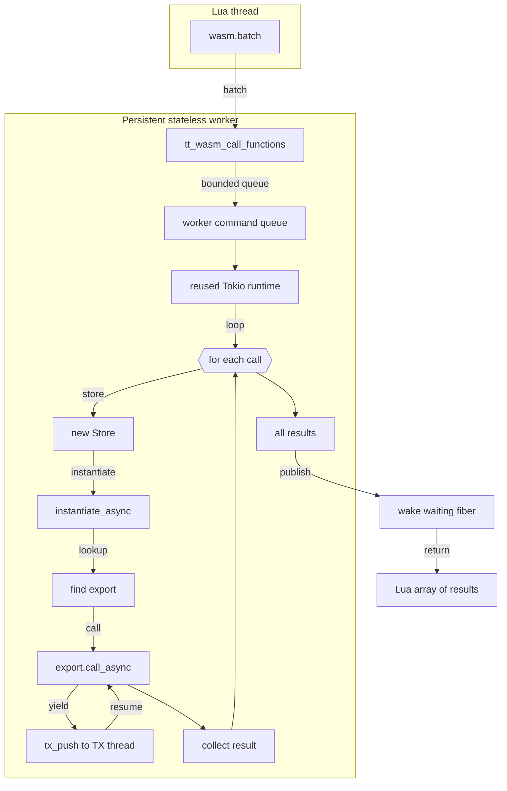

# WASM Component Execution

This document describes how the `run` function works (which calls `wasi:cli.run`) as well as the mechanism for calling exported functions in the `tarantool-wasm-rs` library.

## Running a Module with `run`

1. A Lua script calls `wasm.run(module_uid)` from the `wasm` module (see `src/lua/api.rs`).
2. The `run` function invokes `tt_wasm_run_module`, which creates a separate OS thread and launches a `WasmFiber` within it.
3. `WasmFiber` sets up a `tokio` runtime and asynchronously instantiates the component using `wasmtime_wasi::p2::bindings::Command`.
4. Once initialized, it calls `wasi_cli_run().call_run` on the instance, which triggers execution of the WASM module logic.
5. While the module is running, any tasks that require interaction with Tarantool are forwarded to the TX thread using `tx_push`/`tx_flush`.

`wasm.run` returns a join handle as soon as the worker has published its
cancellation channel; it does not wait for component execution to finish.
`wasm.join(handle)` consumes the handle and waits for the worker with
`coio_call`, allowing the Tarantool fiber to yield while the OS thread is
joined.

If Lua calls `wasm.cancel(handle)`, the runtime latches a cancellation flag,
sends a `Canceled` status, and starts a 2 ms engine epoch ticker while the
guest task is active. At the next epoch checkpoint this Store traps; the
`WasmFiber` reports `Canceled` and aborts the task. `wasm.cancel` joins the OS
worker before returning. Cancellation cannot preempt a blocking host call or
native code, and OS scheduling gives no strict wall-clock upper bound. Every
other Store sharing the Engine rearms its deadline on these ticks. Stores
created for sessions, interpreters, and stateless calls use the same callback;
they trap when runtime shutdown begins. The shutdown path continues advancing
both engine epochs until all active workers exit.

At Tarantool shutdown the runtime rejects new work, interrupts running stores,
closes the stateless worker pool, sessions, and shared interpreters, cancels
background runs, services any remaining TX callbacks, rejects stateless jobs
that have not started, and joins all worker threads before shutdown proceeds.

## Calling Exported Functions

To invoke an exported function, use `wasm.call(module_uid, func, ...)`:

1. The runtime submits the call to a bounded pool of persistent stateless workers.
2. The selected worker reuses its OS thread and Tokio runtime, but creates a fresh `Store` and component instance for the call.
3. The export is located by name, arguments and results are converted to/from MsgPack, and `call_async` is executed.
4. Publishing the result wakes the waiting Tarantool fiber directly.

The pool is created lazily, uses between 2 and 32 workers according to
available parallelism, and has a bounded queue of 32 jobs per worker. A nested
call cannot be dispatched to a worker already present in its active call
chain. If all eligible queues are full, the call returns an explicit
backpressure error instead of growing an unbounded queue or deadlocking.

Loaded components are compiled once and cached by canonical path, source
bytes, and fuel mode. Repeated loads of an unchanged file reuse the compiled
`Component`; they do not share a `Store`, instance, or guest state unless the
session or shared-interpreter APIs are used. The cache holds at most 32
compiled components and evicts the oldest entry when full.
Each cached component also keeps Wasmtime's `InstancePre`, so linker work is
performed once at load time and reused by calls, sessions, interpreters, and
background runs. A persistent Wasmtime compilation cache additionally avoids
recompiling unchanged components after a Tarantool restart.

Both the regular and fuel-enabled Wasmtime engines use the pooling instance
allocator. Component metadata, core instances, linear memories, tables, async
stacks, and GC heaps are taken from preallocated pools and returned when the
owning `Store` is dropped. Each pool has 1,000 slots on 64-bit targets and 100
on 32-bit targets. The pools are separate for regular and fuel-enabled modules;
their limits apply to all execution models sharing the corresponding engine.
Pool exhaustion is reported as an instantiation error instead of allocating
outside the configured bound. A `memory_limit` still controls committed guest
linear memory per store; it does not reduce the allocator's virtual-address
reservation.

Pooling also imposes explicit structural bounds on each component: at most one
linear memory and one table per core module, at most 20,000 elements per table,
and at most 1 MiB each for a component instance's aggregate metadata and an
individual core instance's metadata. A linear memory may be at most 4 GiB on
64-bit targets and 10 MiB on 32-bit targets. These engine-level bounds apply
even when the module configuration omits `memory_limit`; a component that
exceeds one of them fails during instantiation with the Wasmtime limit error.

For large components, an AOT artifact removes compilation from the load path:

```lua
wasm.precompile('python.wasm', 'python.cwasm')
local m = wasm.load('python.cwasm', { precompiled = true })
```

The opt-in is intentional: deserialization maps native executable code and is
safe only for trusted artifacts. A `.cwasm` file is tied to the target platform,
Wasmtime version, and runtime engine settings. When fuel is enabled, use the
same `max_instructions` setting for `precompile` and `load`.

### Executing Multiple Functions Sequentially

Sometimes it’s necessary to call several exports in sequence with one worker
dispatch. For this purpose, a `wasm.batch` function is available, which takes
a list of calls:

```lua
local results = wasm.batch(m, {
    {"func1", arg1, arg2, ...},
    {"func2", ...},
})
```

All functions are executed by one selected pool worker. The result is returned
as a Lua array of values. Each export is executed in its own `Store` and
component instance, while the worker's OS thread and Tokio runtime are reused.

## Long-Lived Sessions

For workloads that need state to persist between calls, use session-based APIs:

```lua
local s = wasm.open_session(module_uid)
local value = wasm.session_call(s, "func", arg1, arg2)
local values = wasm.session_batch(s, {
    {"func1", ...},
    {"func2", ...},
})
wasm.close_session(s)
```

A session keeps one component instance and one store alive across calls, allowing in-memory guest state and resources to be reused between invocations.
Calling `wasm.drop(module_uid)` closes all sessions belonging to that module.

`wasm.bind(module_uid)` uses the same execution model for a regular module. It
opens a managed session, routes bound exports and resource methods through that
session, and closes the session when the last Lua proxy or resource releases
its lease.

## Shared Interpreter Mode

For interpreter components (large WASM binaries), enable shared mode at load:

```lua
local m = wasm.load(path, { interpreter = true })
```

In this mode the runtime keeps one warmed interpreter instance per canonical
component path. Loading the same path again reuses that instance only when the
full configuration is identical; a different configuration is rejected. The
instance is closed after the last module identifier for that path is dropped.
All Tarantool clients using that path observe the same guest state, and calls
are executed sequentially by one worker. A failed `interpreter_exec` or
`interpreter_call` returns an error without discarding the instance. A WASM
trap, including exhausted fuel or a memory fault, recreates the instance, so
all accumulated guest state is lost before the next operation.

`wasm.bind(module_uid)` does not open another session for a module loaded with
`interpreter = true`. The proxy retains the existing shared interpreter entry
and sends static WIT export calls, resource methods, and resource drops to its
command queue. It also exposes module-bound `interpreter_exec(code)` and
`interpreter_call(func, ...)` helpers. All these operations therefore observe
the same guest state and resource table.

Resource handles are tied to the component instance that created them. Proxies
for module identifiers backed by the same shared interpreter can exchange
handles. A trap replaces the interpreter's `Store`, component instance, and
resource table; handles created by the previous instance become invalid.

### Example - Python interpreter

Use dedicated APIs:

```lua
wasm.interpreter_exec(m, [[
counter = 0
def next():
    global counter
    counter += 1
    return counter
]])

local v1 = wasm.interpreter_call(m, "next") -- 1
local v2 = wasm.interpreter_call(m, "next") -- 2
```

Data passed to `interpreter_call` is encoded as MessagePack array and forwarded
to the component `call(func, args_msgpack)` export. Returned MessagePack bytes
are decoded back into Lua values.

Interpreter mode does not make executed source trustworthy. WASI environment,
standard streams, and networking are inherited by default. Restrict those
options and set `memory_limit` and `max_instructions` when the source may be
unbounded or supplied by another user. Without fuel, an infinite loop blocks
every caller sharing the interpreter.

The checked-in Python fixture and its pinned build instructions live in
`python-interpreter/`.

## Diagrams

The persistent execution diagrams show why sessions and interpreters preserve
state while one-shot calls do not. The remaining diagrams describe
`wasm.run`, `wasm.call`, and `wasm.batch`.

### Session and regular `wasm.bind`

Each session owns a dedicated worker, `Store`, component instance, and resource
table. Commands for that session execute sequentially on its worker.



### Shared interpreter and interpreter `wasm.bind`

Interpreter module identifiers for the same canonical path point to one shared
entry. Module-level helpers, bound helpers, static exports, and resources all
use the same command queue and component instance.



### wasm.run



### wasm.call



### wasm.batch


