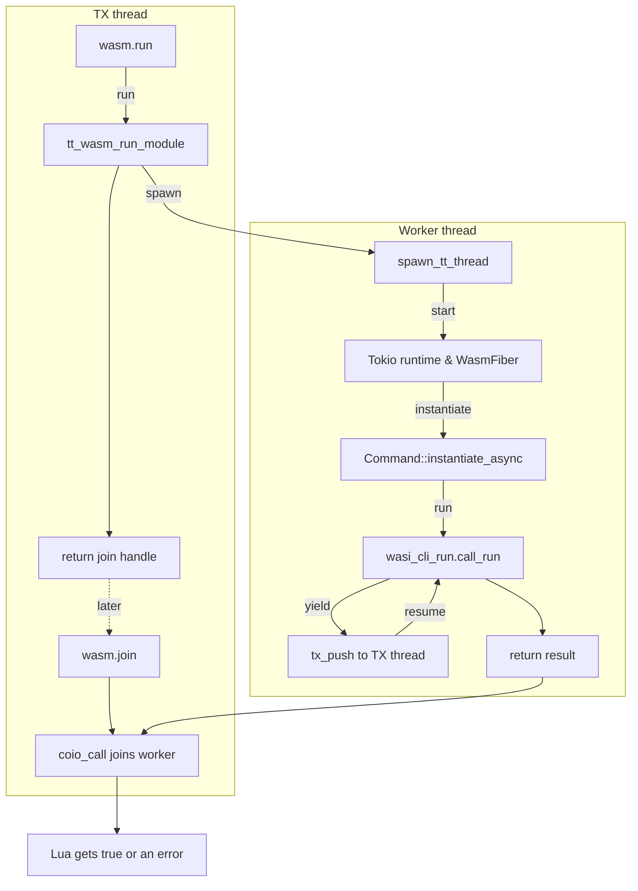
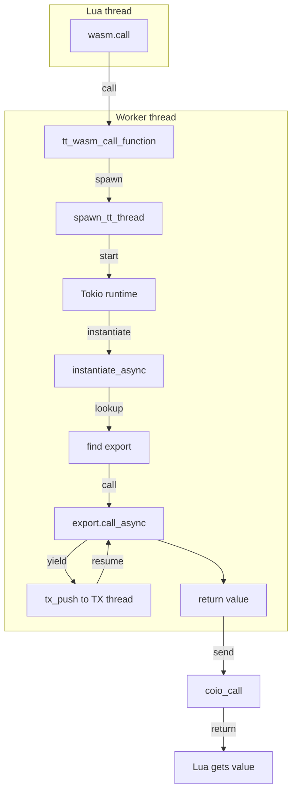
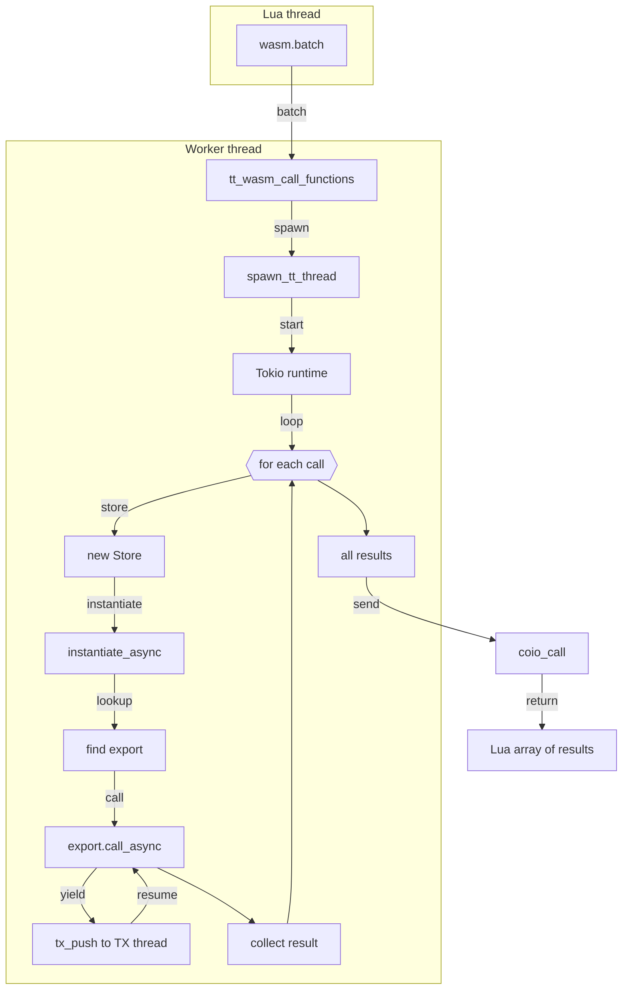

# WASM Component Execution

This document describes how the `run` function works (which calls `wasi:cli.run`) as well as the mechanism for calling exported functions in the `tarantool-wasm-rs` library.

## Running a Module with `run`

1. A Lua script calls `wasm.run(module_uid)` from the `wasm` module (see `src/lua/api.rs`).
2. The `run` function invokes `tt_wasm_run_module`, which creates a separate OS thread and launches a `WasmFiber` within it.
3. `WasmFiber` sets up a `tokio` runtime and asynchronously instantiates the component using `wasmtime_wasi::p2::bindings::Command`.
4. Once initialized, it calls `wasi_cli_run().call_run` on the instance, which triggers execution of the WASM module logic.
5. While the module is running, any tasks that require interaction with Tarantool are forwarded to the TX thread using `tx_push`/`tx_flush`.

`wasm.run` returns a join handle as soon as the worker has published its
cancellation channel; it does not wait for component execution to finish.
`wasm.join(handle)` consumes the handle and waits for the worker with
`coio_call`, allowing the Tarantool fiber to yield while the OS thread is
joined.

If Lua calls `wasm.cancel(handle)`, the runtime sends a `Canceled` status back to the worker. The `WasmFiber`
aborts the asynchronous task running inside the Tokio runtime and the OS thread exits once cleanup is
complete. The Lua helper waits for the join handle to finish so callers can rely on the worker thread being
terminated before continuing.

At Tarantool shutdown the runtime rejects new work, interrupts running stores,
closes sessions and shared interpreters, cancels background runs, services any
remaining TX callbacks, and joins all worker threads before shutdown proceeds.

## Calling Exported Functions

To invoke an exported function, use `wasm.call(module_uid, func, ...)`:

1. The `tt_wasm_call_function` also spawns a separate thread for the WASM execution.
2. Within that thread, the component is instantiated, the export is located by name, and `call_async` is executed.
3. Arguments and results are converted to/from MsgPack.
4. The result is returned to the Lua caller via `coio_call`.

Loaded components are compiled once and cached by canonical path, source
bytes, and fuel mode. Repeated loads of an unchanged file reuse the compiled
`Component`; they do not share a `Store`, instance, or guest state unless the
session or shared-interpreter APIs are used. The cache holds at most 32
compiled components and evicts the oldest entry when full.
Each cached component also keeps Wasmtime's `InstancePre`, so linker work is
performed once at load time and reused by calls, sessions, interpreters, and
background runs. A persistent Wasmtime compilation cache additionally avoids
recompiling unchanged components after a Tarantool restart.

For large components, an AOT artifact removes compilation from the load path:

```lua
wasm.precompile('python.wasm', 'python.cwasm')
local m = wasm.load('python.cwasm', { precompiled = true })
```

The opt-in is intentional: deserialization maps native executable code and is
safe only for trusted artifacts. A `.cwasm` file is tied to the target platform,
Wasmtime version, and runtime engine settings. When fuel is enabled, use the
same `max_instructions` setting for `precompile` and `load`.

### Executing Multiple Functions Sequentially

Sometimes it’s necessary to call several exports in sequence without creating a new thread for each call. For this purpose, a `wasm.batch` function is available, which takes a list of calls:

```lua
local results = wasm.batch(m, {
    {"func1", arg1, arg2, ...},
    {"func2", ...},
})
```

All functions are executed within a single OS thread. The result is returned as a Lua array of values. Each export is executed in its own `Store` and component instance, but without spawning new OS threads.

## Long-Lived Sessions

For workloads that need state to persist between calls, use session-based APIs:

```lua
local s = wasm.open_session(module_uid)
local value = wasm.session_call(s, "func", arg1, arg2)
local values = wasm.session_batch(s, {
    {"func1", ...},
    {"func2", ...},
})
wasm.close_session(s)
```

A session keeps one component instance and one store alive across calls, allowing in-memory guest state and resources to be reused between invocations.
Calling `wasm.drop(module_uid)` closes all sessions belonging to that module.

## Shared Interpreter Mode

For interpreter components (large WASM binaries), enable shared mode at load:

```lua
local m = wasm.load(path, { interpreter = true })
```

In this mode the runtime keeps one warmed interpreter instance per canonical
component path. Loading the same path again reuses that instance only when the
full configuration is identical; a different configuration is rejected. The
instance is closed after the last module identifier for that path is dropped.
All Tarantool clients using that path observe the same guest state, and calls
are executed sequentially by one worker. A failed `interpreter_exec` or
`interpreter_call` returns an error without discarding the instance. A WASM
trap, including exhausted fuel or a memory fault, recreates the instance, so
all accumulated guest state is lost before the next operation.

### Example - Python interpreter

Use dedicated APIs:

```lua
wasm.interpreter_exec(m, [[
counter = 0
def next():
    global counter
    counter += 1
    return counter
]])

local v1 = wasm.interpreter_call(m, "next") -- 1
local v2 = wasm.interpreter_call(m, "next") -- 2
```

Data passed to `interpreter_call` is encoded as MessagePack array and forwarded
to the component `call(func, args_msgpack)` export. Returned MessagePack bytes
are decoded back into Lua values.

Interpreter mode does not make executed source trustworthy. WASI environment,
standard streams, and networking are inherited by default. Restrict those
options and set `memory_limit` and `max_instructions` when the source may be
unbounded or supplied by another user. Without fuel, an infinite loop blocks
every caller sharing the interpreter.

The checked-in Python fixture and its pinned build instructions live in
`python-interpreter/`.

## Diagrams

Below are three separate diagrams for `wasm.run`, `wasm.call`, and `wasm.batch`. Each represents the sequence of actions within its respective thread, with no overlap between the scenarios.

### wasm.run



### wasm.call



### wasm.batch


