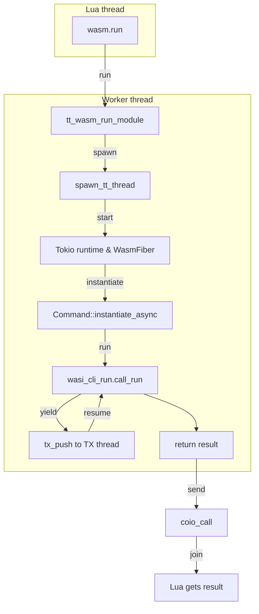
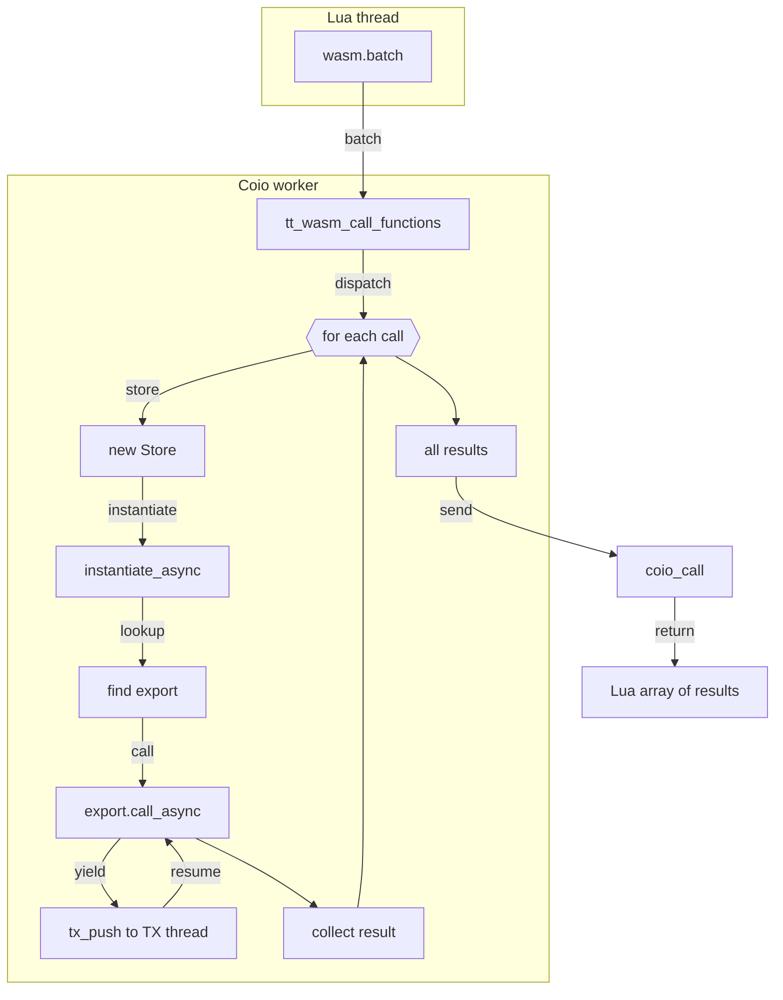

# WASM Component Execution

This document describes how the `run` function works (which calls `wasi:cli.run`) as well as the mechanism for calling exported functions in the `tarantool-wasm-rs` library.

## Running a Module with `run`

1. A Lua script calls `wasm.run(module_uid)` from the `wasm` module (see `src/lib.rs`).
2. The `run` function invokes `tt_wasm_run_module`, which creates a separate OS thread and launches a `WasmFiber` within it.
3. `WasmFiber` sets up a `tokio` runtime and asynchronously instantiates the component using `wasmtime_wasi::p2::bindings::Command`.
4. Once initialized, it calls `wasi_cli_run().call_run` on the instance, which triggers execution of the WASM module logic.
5. While the module is running, any tasks that require interaction with Tarantool are forwarded to the TX thread using `tx_push`/`tx_flush`.

If Lua calls `wasm.cancel(handle)`, the runtime sends a `Canceled` status back to the worker. The `WasmFiber`
aborts the asynchronous task running inside the Tokio runtime and the OS thread exits once cleanup is
complete. The Lua helper waits for the join handle to finish so callers can rely on the worker thread being
terminated before continuing.

## Calling Exported Functions

To invoke an exported function, use `wasm.call(module_uid, func, ...)`:

1. `tt_wasm_call_function` executes the request inside Tarantool's `coio_call` worker context.
2. If instance pooling is enabled (`pool_size > 0`), `wasm.call` reuses a pre-instantiated instance from the module pool.
3. If the pool is empty, the runtime falls back to on-demand instantiation for that call.
4. The export is located by name and `call_async` is executed.
5. The instance is returned back to the pool (when pooling is enabled).
6. Arguments and results are converted to/from MsgPack.
7. The result is returned to the Lua caller via `coio_call`.

`wasm.load(path, { pool_size = N, warm_instances = M })` can prewarm up to `M` instances
(`M` is clamped to `N`) so that first calls avoid cold instantiation latency.

### Executing Multiple Functions Sequentially

Sometimes it’s necessary to call several exports in sequence without creating a new thread for each call. For this purpose, a `wasm.batch` function is available, which takes a list of calls:

```lua
local results = wasm.batch(m, {
    {"func1", arg1, arg2, ...},
    {"func2", ...},
})
```

All functions are executed in `coio_call` worker context. The result is returned as a Lua array of values. Without pooling, each export is executed in its own `Store` and component instance.

When instance pooling is enabled (`pool_size > 0`), each call in `wasm.batch` first tries to borrow a ready instance from the module pool and returns it back after success. If the pool is empty, the runtime falls back to on-demand instantiation for that call.

## Diagrams

Below are three separate diagrams for `wasm.run`, `wasm.call`, and `wasm.batch`. Each represents the sequence of actions within its respective thread, with no overlap between the scenarios.

### wasm.run



### wasm.call

```mermaid
flowchart TD
    subgraph Lua thread
        LC[wasm.call]
    end

    LC -- call --> FC[tt_wasm_call_function]

    subgraph Coio worker
        FC -- dispatch --> TR[Tokio runtime (pooled instance)]
        TR -- instantiate --> CI[instantiate_async]
        CI -- lookup --> Find[find export]
        Find -- call --> CCall[export.call_async]
        CCall -->|yield| TX[tx_push to TX thread]
        TX -->|resume| CCall
        CCall --> CDone[return value]
    end

    CDone -- send --> CoioCall[coio_call]
    CoioCall -- return --> ReturnCall[Lua gets value]
```

### wasm.batch


